# Project Context

## Application
- **Name:** SCS Core (Sopra Crypto Solutions)
- **Type:** Web / API
- **Domain:** Banking / FinTech / Cryptocurrency

## Tech Stack
- **Frontend:** Web UI (customer and bank user interfaces)
- **Backend:** AWS EKS (Kubernetes microservices architecture)
- **Database:** AWS DocumentDB, S3, EFS
- **API Type:** REST API
- **Cloud Infrastructure:** AWS (EKS, Cognito, API Gateway, WAF, GuardDuty, Secrets Manager, CloudWatch)
- **Container Orchestration:** Kubernetes with Cluster Autoscaler and Horizontal Pod Autoscaler (HPA)

## Environment
- **Dev URL:** [NEEDS CLARIFICATION - Not specified in requirements]
- **Staging URL:** [NEEDS CLARIFICATION - Not specified in requirements]
- **Prod URL:** [NEEDS CLARIFICATION - Not specified in requirements]

---

## Diagrams

### Figure 1 - Overview of the Solution
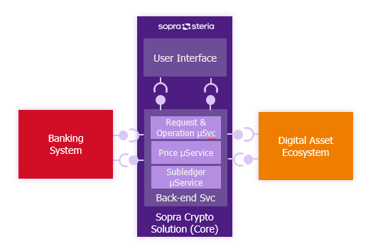

### Figure 2 - Capability Map
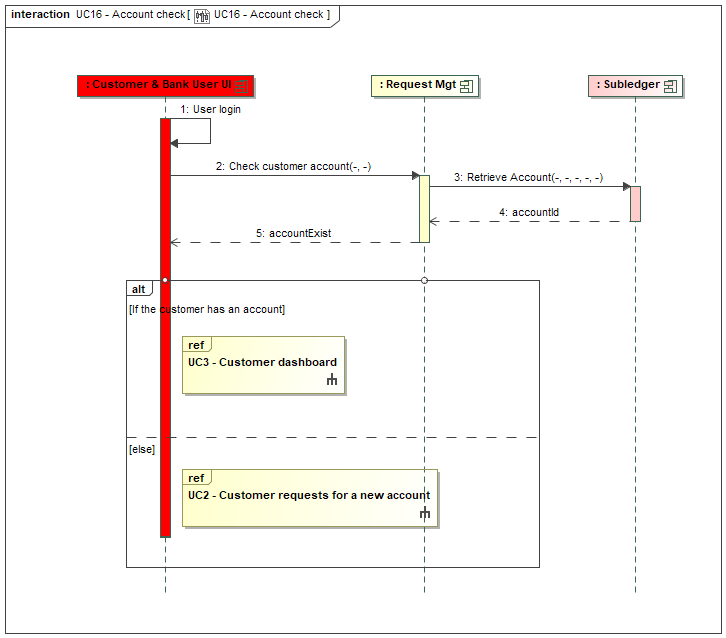

### Figure 3 - Subledger Concepts
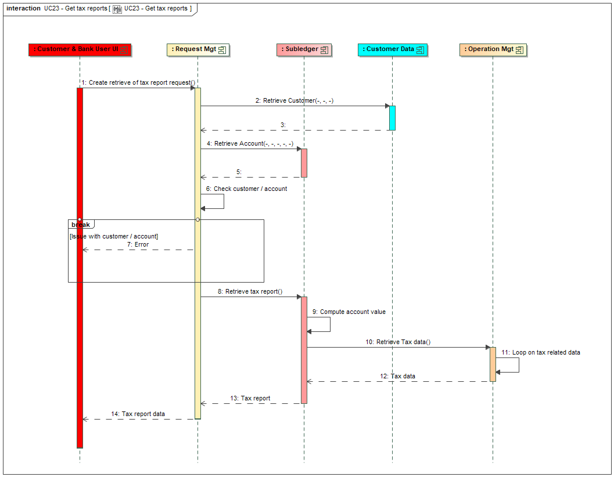

### Figure 4 - Application Architecture
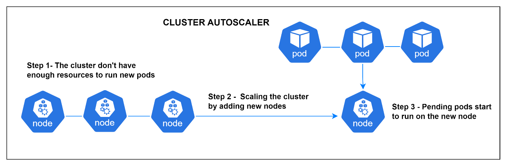

### Figure 5 - Deployment
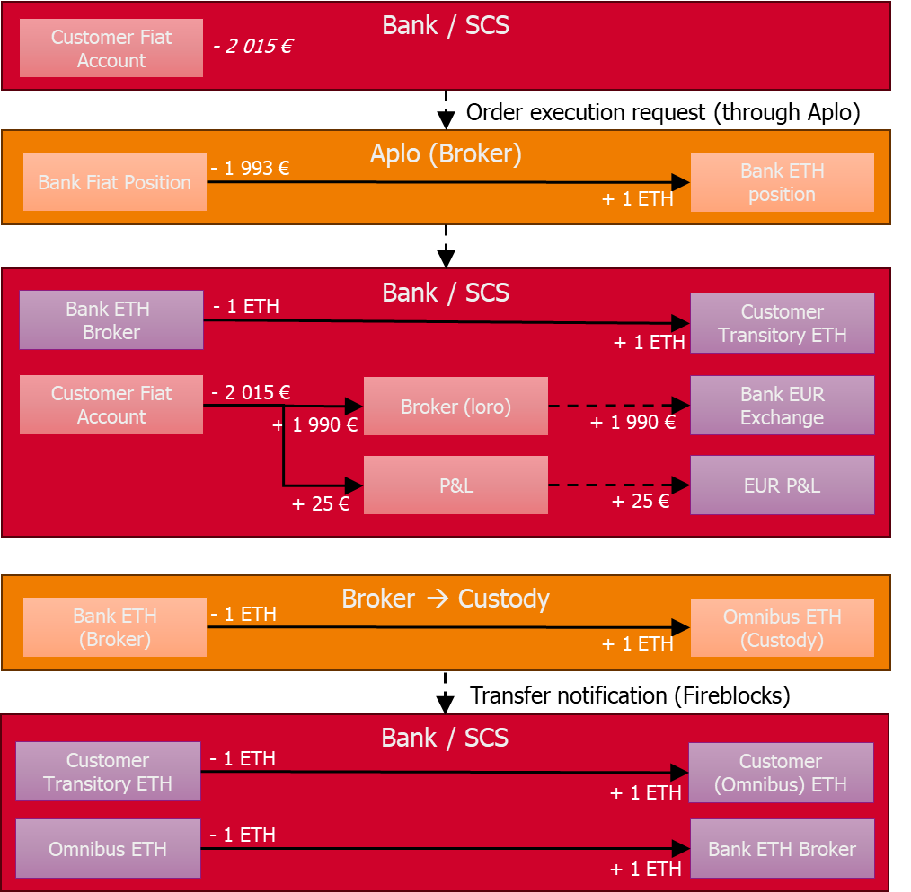

### Figure 6 - Link Components vs Capabilities
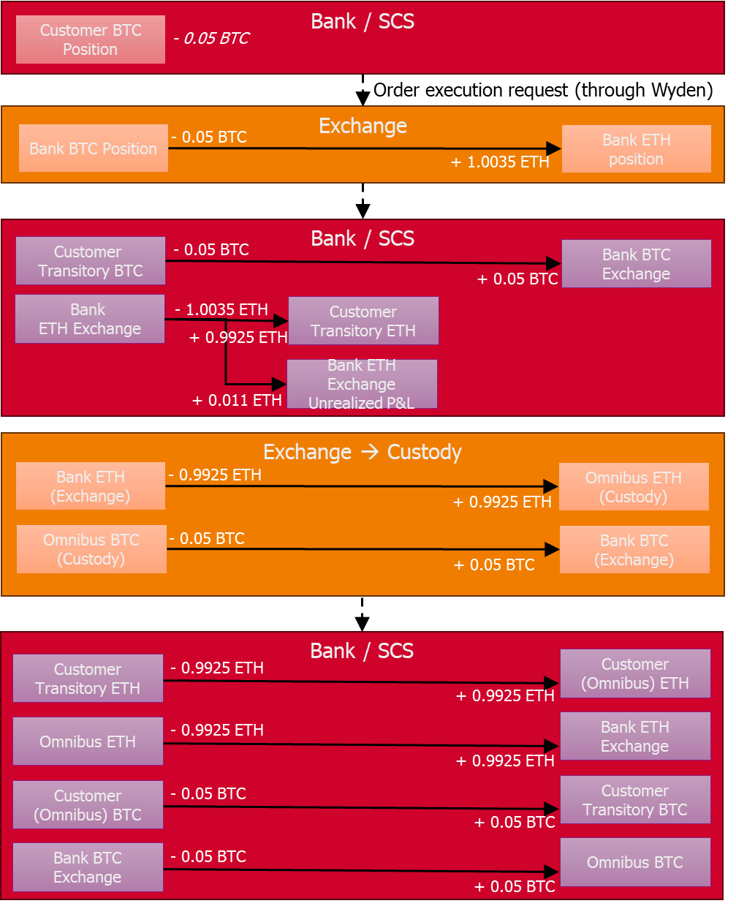

### Figure 36 - Architecture Principles
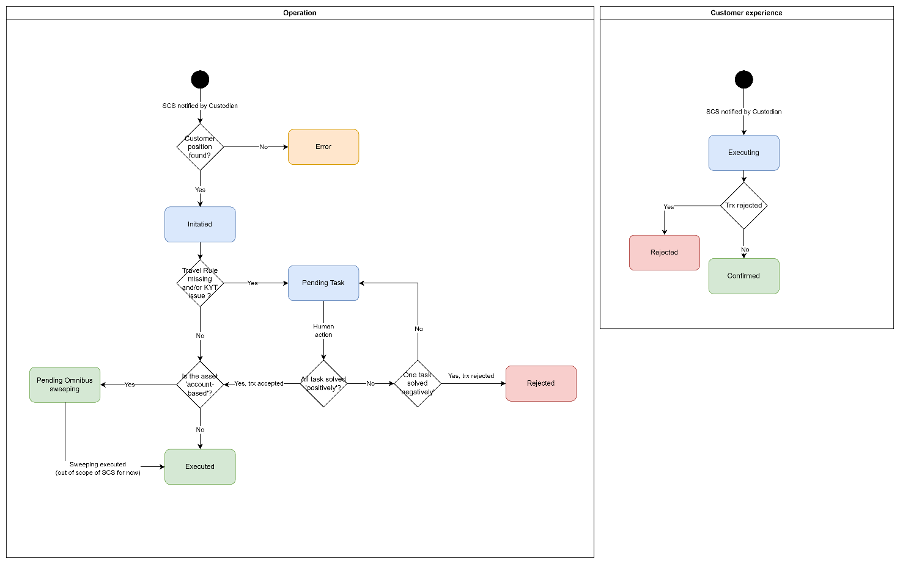

### Figure 37 - Technology Stack
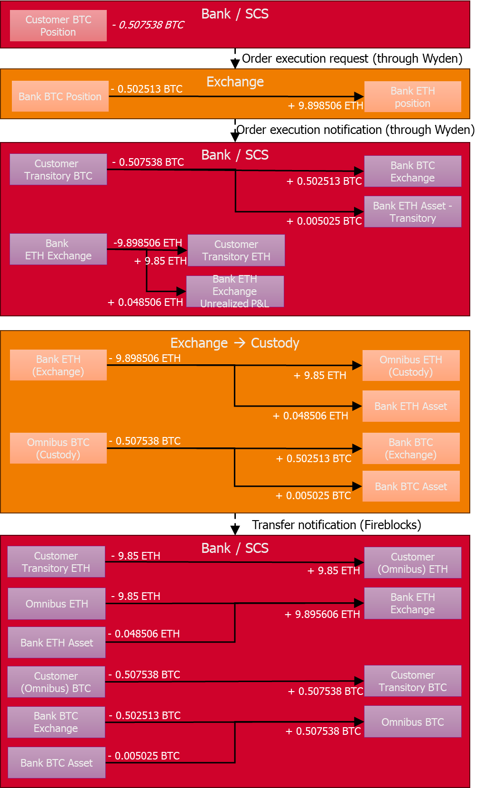

### Figure 38 - Current Infrastructure
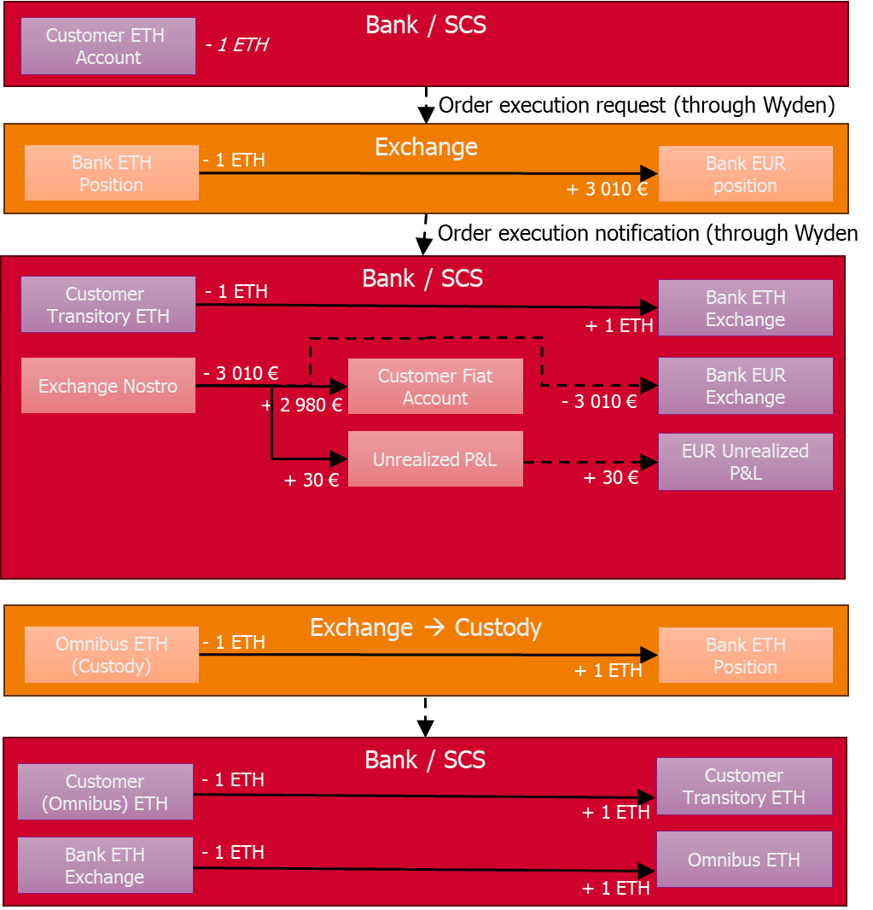

### Figure 39 - Target Infrastructure
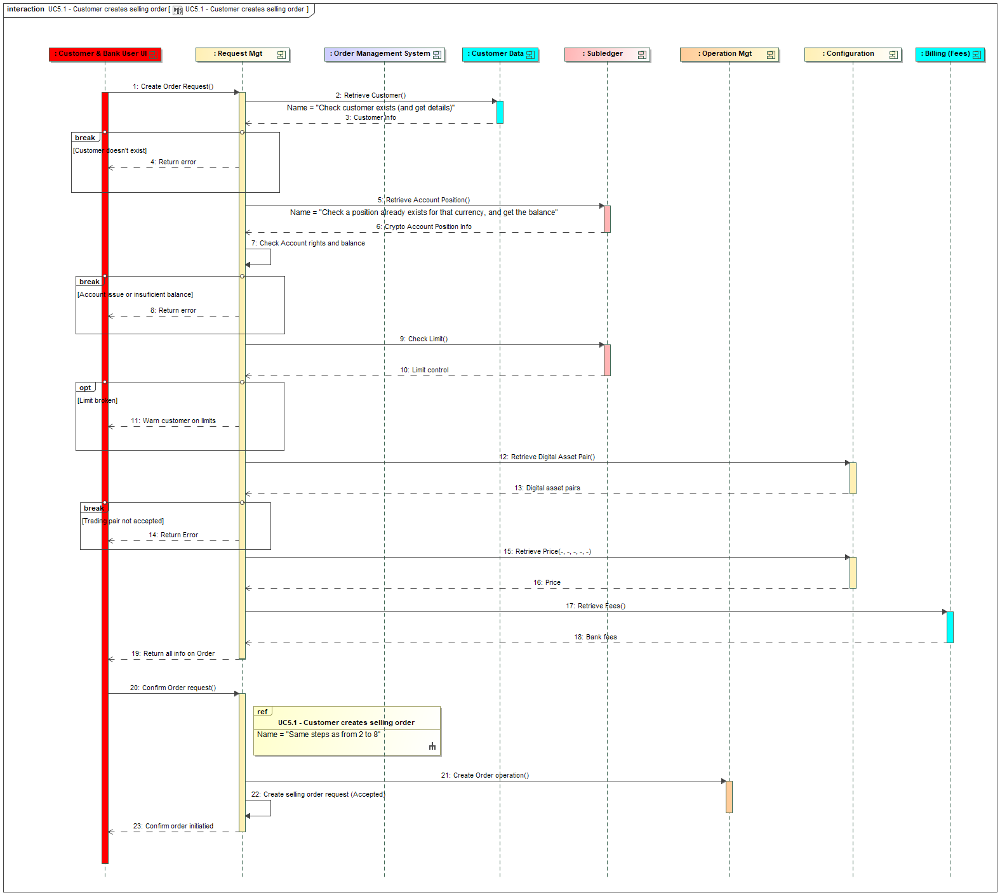

### Figure 40 - Cluster Autoscaler
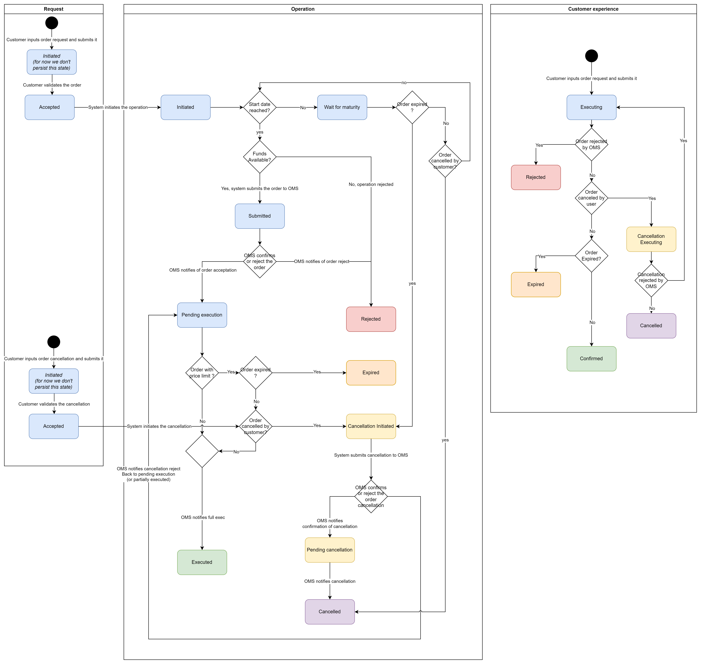

### Figure 41 - Horizontal Pod Autoscaler
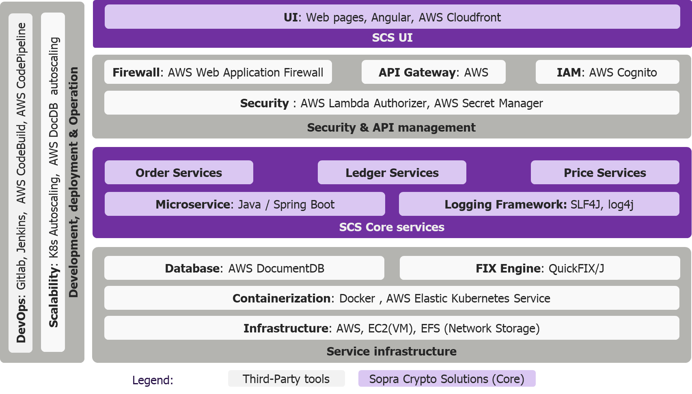

---

## Architecture Overview
- **Deployment:** Private subnets within AWS VPC with EKS workloads
- **Security:** Multi-layered approach including Security Groups, NACLs, AWS Network Firewall, Kubernetes Network Policies, Service Mesh (Istio)
- **Authentication:** AWS Cognito with OAuth2, MFA, enterprise SSO integration
- **Encryption:** TLS 1.3 for data in transit, AWS KMS for data at rest

## External Integrations
- **Custodians:** Fireblocks, Taurus (for blockchain interactions and security)
- **Order Management System (OMS):** Wyden
- **Exchange Venues:** Kraken, Coinbase
- **KYT/AML Provider:** Chainalysis
- **Core Banking System (CBS):** Integration via defined API endpoints

## Key Constraints
- All API communications must use HTTPS with TLS 1.3
- JWT tokens required for all API calls with attributes: sub, iat, exp, client, customer, role
- Idempotency management required for state-changing API endpoints
- Rate limiting and throttling enforced via AWS API Gateway and WAF
- Data encryption at rest using AWS KMS (EBS, S3, EFS, DocumentDB)
- Role-Based Access Control (RBAC) enforced at UI and API levels
- Asset-link based access control for customer resources
- Logs must not contain PII - only technical IDs allowed
- Amount formatting: 2 significant digits after decimal separator (minimum)
